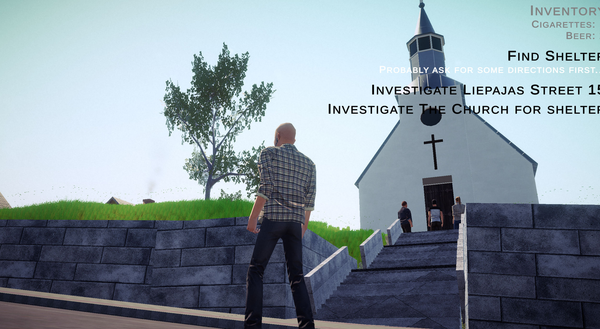
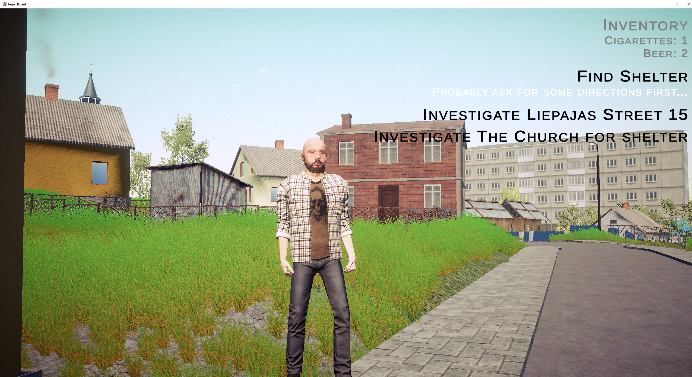
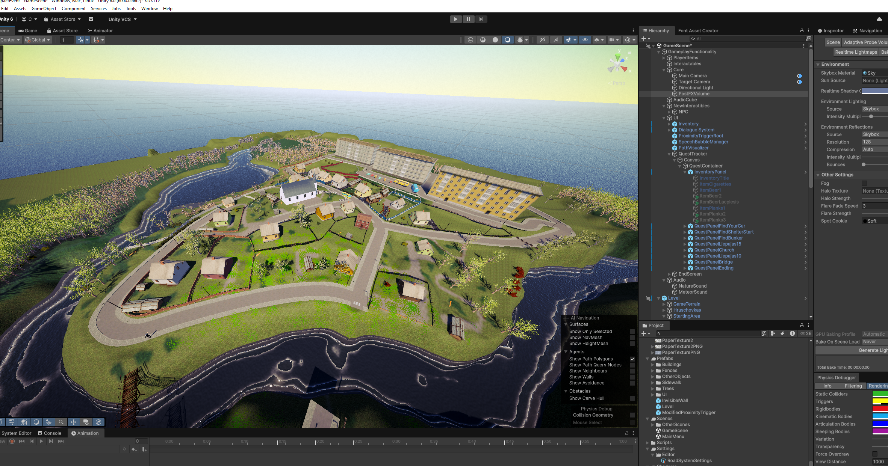
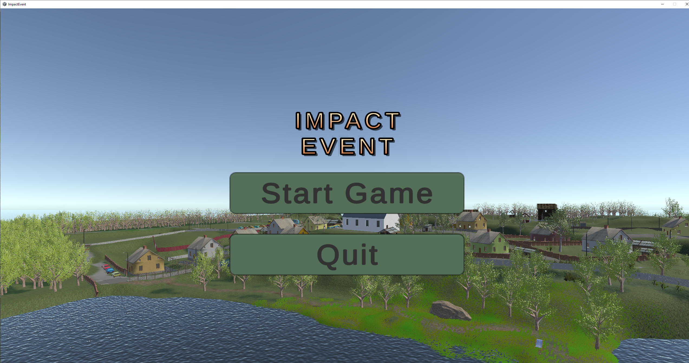
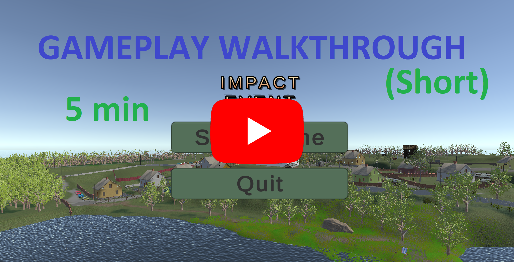
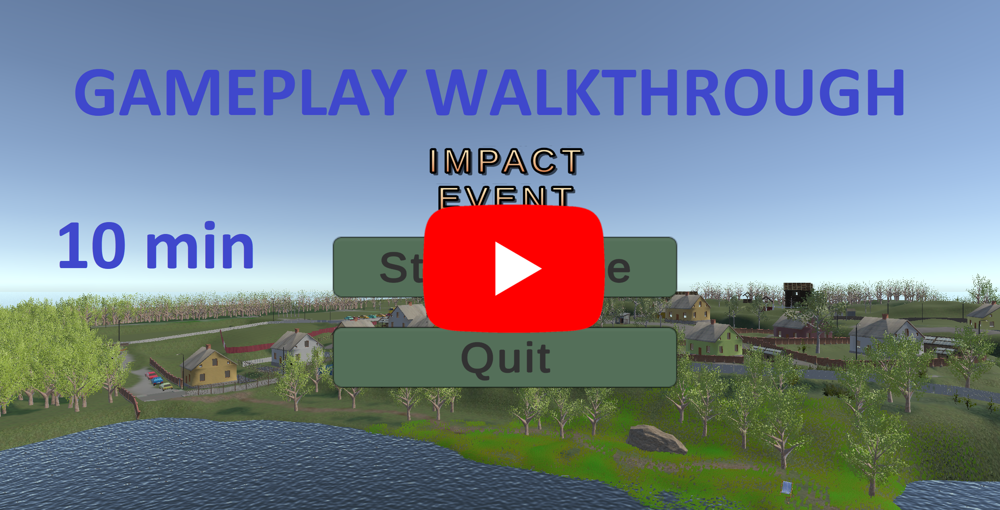

# Impact Event

Impact Event is a short narrative walking simulator I made for the Unity Fundamentals
and Design Fundamentals modules during the Beginning Serious Game Design minor at
Saxion University of Applied Sciences.

A quiet day by the lake is interrupted by a meteor warning. You explore a small
Latvian town in the 90s. You talk to its weird residents and try to look for shelter, by having surreal and absurd conversations.

## Work

I worked on the town and terrain layout, dialogue and quests, and custom gameplay
scripts built around the provided framework. Some examples in this repository:

- [Proximity interactions](Assets/Scripts/ModifiedProximityTrigger.cs) and
  [object highlighting](Assets/Scripts/ObjectHighlighter.cs).
- [Camera sequencing](Assets/Scripts/CameraDirector.cs) for story moments.
- [Audio interactions](Assets/Scripts/ModifiedAudioTrigger.cs), including spatial
  sound and fades.
- [Yarn commands](Assets/TheOneFramework/Core/YarnSpinnerFunctions/YarnSpinnerFunctions.cs)
  extended to control cameras, character facing, objective text and audio.
- [Yarn script dialogue](Assets/Dialogue/ImpactEventScript.yarn) that includes dialogue and gameplay triggers

## Screenshots

*By a church*

*Walking around*

*Map Overview*

*Main Menu*

## Gameplay walkthrough

*Short Walkthrough*

*Unedited Walkthrough*

## Source and credits

Made with Unity **6000.0.66f2**, [TheOneFramework](https://github.com/YvensFaos/TheOneFramework),
Yarn Spinner and Cinemachine.

This repository contains selected source code. Some assets and dependencies are
omitted, so it is not a complete runnable Unity project.
